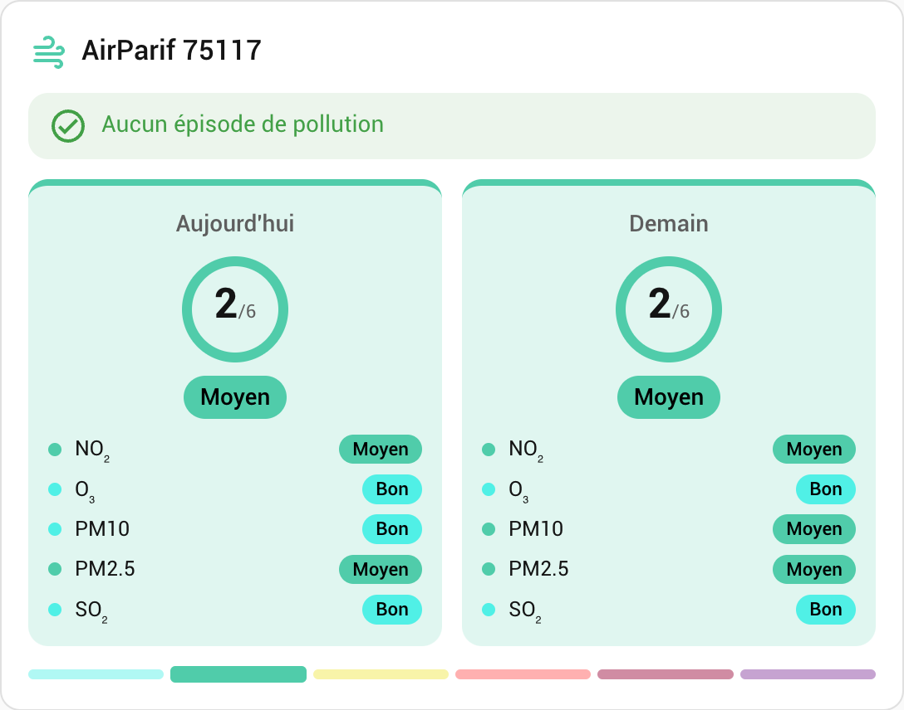

# AirParif pour Home Assistant

🇫🇷 Français · 🇬🇧 [English](#airparif-for-home-assistant)

Intégration personnalisée qui expose dans Home Assistant, sous forme de capteurs,
les prévisions de qualité de l'air AirParif par commune
(`/indices/prevision/commune`) et les épisodes de pollution en Île-de-France
(`/episodes/en-cours-et-prevus`).

## Installation

[](https://my.home-assistant.io/redirect/marketplace_repository/?owner=Djailla&repository=ha-airparif&category=integration)

Cliquez sur le bouton ci-dessus pour ajouter ce dépôt au Marketplace de Home Assistant
(version 2026.11 ou plus récente). Vous pouvez aussi copier `custom_components/airparif`
dans le dossier `config/custom_components/` de votre Home Assistant.

Redémarrez ensuite Home Assistant, puis allez dans **Paramètres → Appareils et
services → Ajouter une intégration → AirParif**.

## Configuration

| Champ | Description |
|-------|-------------|
| Clé d'API | Votre clé d'API AirParif |
| Code INSEE | Code INSEE à 5 chiffres de la commune, par exemple `75117` pour Paris 17e |

- **Clé d'API** : demandez-la sur la
  [page de l'API AirParif](https://www.airparif.fr/interface-de-programmation-applicative).
- **Code INSEE** : ce n'est pas le code postal. Retrouvez-le à partir du code postal
  dans la
  [table de correspondance code INSEE / code postal](https://hub.huwise.com/explore/assets/correspondance-code-insee-code-postal/view/).

Une entrée de configuration par commune. Si la clé est refusée par la suite, Home
Assistant lance une procédure de réauthentification.

## Entités

Pour chaque commune configurée (un appareil) :

- **Qualité de l'air aujourd'hui / demain** : indice ATMO, capteur de type énumération
  avec les états `bon`, `moyen`, `degrade`, `mauvais`, `tres_mauvais`,
  `extremement_mauvais`. Attributs : `index` (de 1 à 6), `forecast_date`, `pollutants`.
- **NO₂, O₃, PM10, PM2.5, SO₂ aujourd'hui / demain** : niveau par polluant. Ceux du
  jour sont activés par défaut, ceux du lendemain sont désactivés par défaut.
- **Épisode de pollution aujourd'hui / demain** : capteur binaire, à `on` lorsqu'un
  épisode de pollution est en cours ou prévu. Les épisodes concernent toute la région,
  pas une commune en particulier. Attributs : `pollutants` (niveau d'épisode par
  polluant tel que renvoyé par AirParif, `null` s'il n'y en a pas) et `message` (texte
  d'AirParif, en français ou en anglais selon la langue de Home Assistant).

Les capteurs sont `unavailable` (indisponibles) lorsque la prévision ne couvre pas le
jour concerné. Les capteurs d'épisode sont indisponibles lorsque l'appel aux épisodes
échoue ; les capteurs de prévision continuent de fonctionner.

Les données sont actualisées toutes les heures.

## Carte

<picture>
  <source media="(prefers-color-scheme: dark)" srcset="https://raw.githubusercontent.com/Djailla/ha-airparif/main/docs/card-dark.png">
  
</picture>

L'intégration fournit une carte de tableau de bord, chargée automatiquement : aucune
ressource à ajouter. Elle affiche l'indice ATMO du jour et du lendemain avec les
couleurs officielles, le niveau de chaque polluant, l'échelle ATMO et les épisodes de
pollution en cours ou prévus. Un clic sur un élément ouvre le détail du capteur.

Ajoutez-la depuis **Modifier le tableau de bord → Ajouter une carte → AirParif**, ou en
YAML :

```yaml
type: custom:airparif-card
device_id: <optionnel, par défaut le premier appareil AirParif>
title: <optionnel, par défaut le nom de l'appareil>
show_pollutants: true
tint: true            # teinte chaque jour avec la couleur de son indice
colors:               # optionnel : remplace les couleurs officielles ATMO
  bon: "#2E7D32"      # toute couleur CSS…
  moyen: [21, 101, 192]  # …ou [r, g, b]
```

Les niveaux personnalisables sont `bon`, `moyen`, `degrade`, `mauvais`,
`tres_mauvais` et `extremement_mauvais`. Les couleurs se choisissent aussi dans
l'éditeur visuel, section **Couleurs de qualité de l'air**. La couleur du texte
s'adapte automatiquement pour rester lisible.

---

# AirParif for Home Assistant

🇬🇧 English · 🇫🇷 [Français](#airparif-pour-home-assistant)

Custom integration exposing, as Home Assistant sensors, the AirParif air-quality
forecast for a commune (`/indices/prevision/commune`) and the Île-de-France pollution
episodes (`/episodes/en-cours-et-prevus`).

## Installation

[](https://my.home-assistant.io/redirect/marketplace_repository/?owner=Djailla&repository=ha-airparif&category=integration)

Click the button above to add this repository to the Home Assistant Marketplace
(Home Assistant 2026.11 or later). You can also copy `custom_components/airparif`
into the `config/custom_components/` folder of your Home Assistant.

Then restart Home Assistant and go to **Settings → Devices & services → Add
integration → AirParif**.

## Configuration

| Field | Description |
|-------|-------------|
| API key | Your AirParif API key |
| INSEE code | 5-digit INSEE code of the commune, e.g. `75117` for Paris 17e |

- **API key**: request one on the
  [AirParif API page](https://www.airparif.fr/interface-de-programmation-applicative).
- **INSEE code**: this is not the postal code. Look it up from the postal code in the
  [INSEE / postal code table](https://hub.huwise.com/explore/assets/correspondance-code-insee-code-postal/view/).

One config entry per commune. If the key is later rejected, Home Assistant starts a
re-authentication flow.

## Entities

For each configured commune (one device):

- **Air quality today / tomorrow**: ATMO index, an enum sensor with the states `bon`,
  `moyen`, `degrade`, `mauvais`, `tres_mauvais`, `extremement_mauvais`. Attributes:
  `index` (1 to 6), `forecast_date`, `pollutants`.
- **NO₂, O₃, PM10, PM2.5, SO₂ today / tomorrow**: per-pollutant level. Today's are
  enabled by default, tomorrow's are disabled by default.
- **Pollution episode today / tomorrow**: binary sensor, `on` when a pollution
  episode is ongoing or forecast. Episodes cover the whole region, not a single
  commune. Attributes: `pollutants` (episode level per pollutant as reported by
  AirParif, `null` when none) and `message` (AirParif's text, in French or English
  depending on the Home Assistant language).

Sensors are `unavailable` when the forecast does not cover the day. The episode
sensors are `unavailable` when the episodes call fails; the forecast sensors keep
working.

Data is refreshed hourly.

## Card

<picture>
  <source media="(prefers-color-scheme: dark)" srcset="https://raw.githubusercontent.com/Djailla/ha-airparif/main/docs/card-dark.png">
  
</picture>

The integration ships a dashboard card that is loaded automatically: there is no
resource to add. It shows today's and tomorrow's ATMO index in the official colors,
the level of each pollutant, the ATMO scale, and any ongoing or forecast pollution
episode. Clicking an item opens the sensor's details.

Add it from **Edit dashboard → Add card → AirParif**, or in YAML:

```yaml
type: custom:airparif-card
device_id: <optional, defaults to the first AirParif device>
title: <optional, defaults to the device name>
show_pollutants: true
tint: true            # tint each day with its index color
colors:               # optional: override the official ATMO colors
  bon: "#2E7D32"      # any CSS color…
  moyen: [21, 101, 192]  # …or [r, g, b]
```

The levels you can recolor are `bon`, `moyen`, `degrade`, `mauvais`,
`tres_mauvais` and `extremement_mauvais`. Colors can also be picked in the visual
editor, under **Air-quality colors**. The text color adapts automatically to stay
readable.
